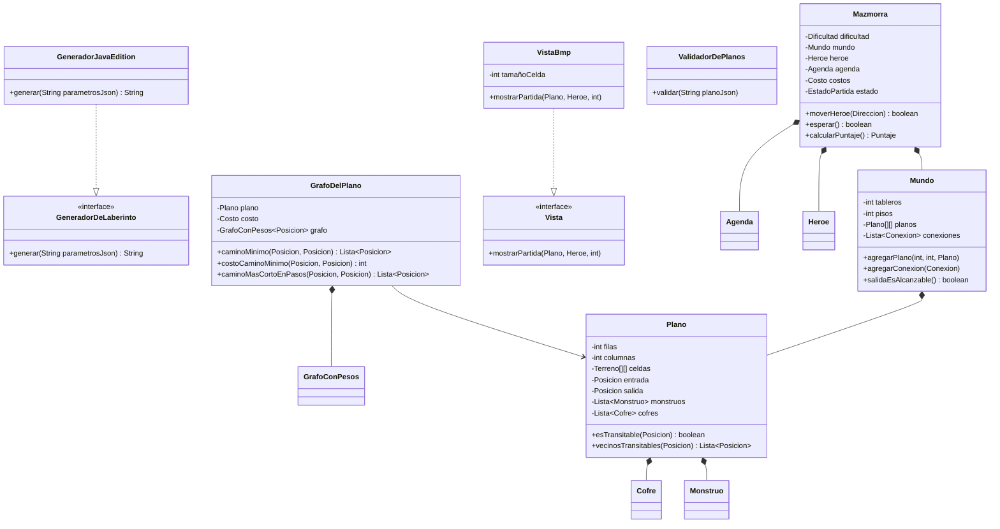
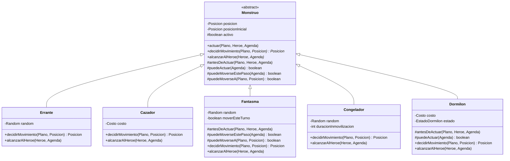
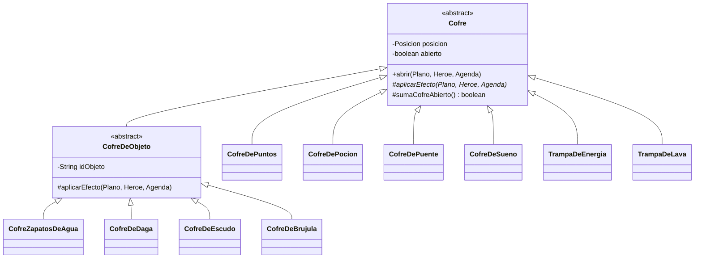

# Informe Técnico — TP2: La Fuga de la Mazmorra

- **Materia:** CB100 Algoritmos y Estructuras de Datos — Cátedra Ing. Gustavo Schmidt (2C 2026)
- **Grupo:** `JavaEdition`
- **Integrantes:**
  - **Sabri** — Modelo Base (`Mazmorra`, `Mundo`, `Plano`, `Heroe`, `Agenda`, `ColocadorDeConexiones`)
  - **Franco** — Estructuras de Datos (`Lista`, `Pila`, `Cola`, `ColaDePrioridad`, `TablaHash`, `ArbolAVL`, `GrafoConPesos`)
  - **Lukas** — Generación de Laberintos, Validador y Grafos del Plano (`GeneradorJavaEdition`, `ValidadorDePlanos`, `GrafoDelPlano`)
  - **Sofía Toledo** — Entidades Polimórficas (`Monstruo` x5, `Cofre` x10, `Objeto` x6, `Catalogo<T>`)
  - **Sofi R** — Persistencia y Vista (`LectorConfiguracion`, `PersistenciaMazmorra`, `PersistenciaRanking`, `VistaBmp`)
  - **Santi** — Integración General, Programa Principal (`Main`) y Pruebas de Punta a Punta

---

## 1. Decisiones de Diseño y Arquitectura

El proyecto fue diseñado aplicando separación estricta de responsabilidades entre el **modelo del dominio**, las **estructuras de datos**, el **generador de laberintos**, la **persistencia en JSON** y la **vista gráfica (BMP)**.

### 1.1. Regla de Oro y Desacoplamiento
Se respetó en todo momento la regla central del enunciado: **el modelo no sabe cómo se dibuja ni cómo se guarda**.
- Ninguna clase dentro de `modelo/`, `entidades/` ni `estructuras/` importa `javax.imageio.ImageIO`, `java.awt.image.BufferedImage`, `Swing` ni `com.google.gson.Gson`.
- Las dos fronteras hacia el exterior están gobernadas por interfaces:
  1. `GeneradorDeLaberinto`: desacopla la creación del plano mediante un contrato de texto JSON (`String generar(String parametrosJson)`), permitiendo intercambiar nuestro `GeneradorJavaEdition` por el de cualquier otro grupo sin modificar el modelo.
  2. `Vista`: abstrae la representación visual de un turno mediante `mostrarPartida(Plano plano, Heroe heroe, int numeroPaso)`, implementada de forma obligatoria por `VistaBmp`.

### 1.2. Uso de Records para Objetos de Valor
Todos los objetos inmutables que representan valores puros o transferencia de estado fueron modelados mediante `record` de Java:
- **En el modelo:** `Posicion(fila, columna)`, `Ubicacion(tablero, piso, posicion)`, `Conexion(origen, destino, tipo)`, `Costo(piso, agua, lava)`, `Puntaje(cofresAbiertos, energiaRestante, pasos)`, `EntradaDeRanking(nombre, puntaje, dificultad, fecha)`, `EventoProgramado(paso, tipo, dato)` y `Configuracion(...)`.
- **En la persistencia:** `MazmorraGuardada`, `MundoGuardado`, `PlanoGuardado`, `HeroeGuardado`, `MonstruoGuardado`, `CofreGuardado`, `AgendaGuardada` y `LavaGuardada`, separados del modelo mediante clases conversoras (`ConversorMazmorra`, `ConversorMundo`, `ConversorPlano`, `ConversorHeroe`, `ConversorEntidades`, `ConversorAgenda`).

### 1.3. Estructuras de Datos y Complejidad
Cada estructura fue seleccionada según las operaciones críticas del juego. Siguiendo el régimen V2 del enunciado, se usa primero la API de Java y las estructuras propias solo donde la API no tiene equivalente (AVL y grafo):

| Estructura | Ubicación y Uso en el TP | Complejidad de Operación Crítica |
| :--- | :--- | :--- |
| **Pila (`ArrayDeque`)** | Backtracking en `GeneradorJavaEdition` y reconstrucción del camino inverso en `GrafoDelPlano` | Apilar y desapilar en $O(1)$ |
| **Cola (`ArrayDeque`)** | BFS en `ValidadorDePlanos` (R5 y R9), alcanzabilidad entre planos en `Mundo.salidaEsAlcanzable()` y `GrafoDelPlano.caminoMasCortoEnPasos()` | Encolar y desencolar en $O(1)$ |
| **Lista (`LinkedList` / `ArrayList`)** | Monstruos y cofres de cada `Plano` y log de la partida (`LinkedList`); conexiones en `Mundo`, caminos y adyacencias en `GrafoConPesos` (`ArrayList`) | Inserción al final en $O(1)$, recorrido en $O(N)$ |
| **Cola de Prioridad (`PriorityQueue`)** | Min-Heap para Dijkstra en `GrafoDelPlano` y eventos temporales en `Agenda` (con desempate FIFO) | Inserción y extracción del mínimo en $O(\log N)$ |
| **Tabla Hash (`HashMap` / `HashSet`)** | Inventario y efectos activos del héroe, celdas visitadas por plano, catálogo de fábricas (`Catalogo<T>`), vértices del grafo y distancias/padres en Dijkstra | Búsqueda e inserción en $O(1)$ promedio |
| **Árbol AVL (`ArbolAVL<T>`)** | `Ranking` de puntajes ordenado de forma balanceada para obtener el Top 10 mediante recorrido in-order | Inserción y búsqueda garantizadas en $O(\log N)$ |
| **Grafo con Pesos (`GrafoConPesos<Posicion>`)** | Base de `GrafoDelPlano`: cada celda transitable es un vértice y cada transición hacia un vecino es una arista dirigida con el costo del terreno destino | Consulta de vértices en $O(1)$ promedio y Dijkstra en $O((|V| + |E|) \log |V|)$ |

---

## 2. Diagramas de Clases y Jerarquías Polimórficas

### 2.1. Arquitectura General del Sistema



### 2.2. Jerarquía Polimórfica de Monstruos (5 Tipos)

La clase abstracta `Monstruo` implementa el patrón **Template Method** en `actuar(Plano, Heroe, Agenda)`: verifica si está activo, ejecuta el gancho `antesDeActuar(...)`, comprueba colisión previa con el héroe, delega la elección de la casilla en el método abstracto `decidirMovimiento(Plano, Posicion)` y, si alcanza al héroe, invoca el método abstracto `alcanzarAlHeroe(Heroe, Agenda)`.



| Tipo de Monstruo | Movimiento (`decidirMovimiento`) | Efecto al Alcanzar (`alcanzarAlHeroe`) |
| :--- | :--- | :--- |
| **`Errante`** | Elige al azar una celda vecina transitable. | Quita 30 de energía (respetando escudo) y vuelve a su posición inicial. |
| **`Cazador`** | Avanza 1 celda por el camino de menor costo de energía hacia el héroe usando Dijkstra (`GrafoDelPlano`). | Quita 30 de energía y vuelve a su posición inicial. |
| **`Fantasma`** | Se mueve cada 2 turnos (`moverEsteTurno`), pero puede atravesar paredes dentro de los límites del plano. | Quita 30 de energía y vuelve a su posición inicial. |
| **`Congelador`** | Se mueve al azar por celdas vecinas transitables. | Quita 15 de energía, inmoviliza al héroe por `N` turnos en la `Agenda` y vuelve al inicio. |
| **`Dormilon`** | Permanece dormido hasta que el héroe entra a distancia Manhattan $\le 3$; al despertar persigue con Dijkstra. | Quita 30 de energía, vuelve a su posición inicial y vuelve a dormirse. |

### 2.3. Jerarquía Polimórfica de Cofres (10 Tipos) y Objetos

`Cofre` define el método plantilla `abrir(Plano, Heroe, Agenda)` que marca el cofre como abierto, contabiliza el cofre para el puntaje si corresponde y delega el comportamiento específico en `aplicarEfecto(Plano, Heroe, Agenda)`. Los cofres que entregan ítems heredan de la subclase intermedia `CofreDeObjeto`.



| Tipo de Cofre | Categoría | Efecto al Abrirse / Usarse |
| :--- | :--- | :--- |
| **`CofreDePuntos`** | Puntos | Suma 1 cofre abierto (+100 pts en la fórmula de puntaje). |
| **`CofreDePocion`** | Curación | Recupera energía inmediatamente al héroe. |
| **`CofreZapatosDeAgua`** | Objeto / Temporal / Terreno | Guarda `zapatos_de_agua` en el inventario; al usarse, durante 20 pasos el agua cuesta como piso. |
| **`CofreDeEscudo`** | Objeto / Temporal | Guarda `escudo`; al usarse, protege al héroe del daño de monstruos durante su duración programada en la `Agenda`. |
| **`CofreDeDaga`** | Objeto / Combate | Guarda `daga`; al usarse, desactiva monstruos cercanos y programa su reactivación en la `Agenda`. |
| **`CofreDeBrujula`** | Objeto / Orientación | Guarda `brujula`; indica la dirección hacia la salida o conexión del plano. |
| **`CofreDeSueno`** | Temporal / Monstruos | Duerme temporalmente a todos los monstruos del plano actual y agenda su despertar. |
| **`CofreDePuente`** | Temporal / Terreno | Convierte celdas de agua/lava cercanas en piso transitable durante 15 pasos y agenda su restauración. |
| **`TrampaDeEnergia`** | Trampa | Resta energía al héroe al abrirlo (no suma como cofre de premio). |
| **`TrampaDeLava`** | Trampa / Temporal / Terreno | Convierte celdas vecinas de piso en lava temporalmente y agenda su restauración. |

---

## 3. Respuestas al Cuestionario

### 1) ¿Por qué la agenda es una cola de prioridad y no una lista ordenada? Comparen insertar y sacar el próximo en cada caso.


### 2) ¿Qué diferencia de costo hay entre buscar en el inventario si es lista y si es tabla hash? ¿Cuántas veces por paso se consulta?


### 3) ¿Por qué el ranking es un ABB y no un arreglo ordenado? ¿Qué pasa si los puntajes llegan en orden creciente, y cómo lo resuelve el AVL?


### 4) Dijkstra en un plano de $25 \times 40$: ¿cuántos vértices y aristas tiene el grafo? ¿Cuál es el costo de un camino mínimo?
- **Vértices ($|V|$):** El plano de $25 \times 40$ tiene $1000$ celdas en total. Como en `GrafoDelPlano` solo agregamos las celdas transitables y la regla R7 exige que sean entre el $30\%$ y el $60\%$ del plano, el grafo tiene **entre 300 y 600 vértices**.
- **Aristas ($|E|$):** Desde cada casilla solo nos podemos mover en 4 direcciones (arriba, abajo, izquierda, derecha), así que cada vértice tiene como máximo 4 aristas salientes. En total hay **como mucho $4 \cdot |V|$ aristas** (máximo 2400 aristas dirigidas, y en promedio alrededor de 1000).
- **Costo de calcular el camino mínimo:** Usando Dijkstra con `PriorityQueue` (Min-Heap) y `HashMap`, la complejidad es $O((|V| + |E|) \log |V|)$. Como $|E| \le 4|V|$, queda en **$O(|V| \log |V|)$**.

### 5) El generador usa su pila y no la recursión de Java. ¿Qué profundidad alcanza la recursión en un plano de $25 \times 40$, y qué pasaría con la pila de la JVM? ¿Por qué el laberinto resultante es conexo, y por qué hay que abrir paredes después para que tenga bifurcaciones?
- **Profundidad y pila de la JVM:** En un plano de $25 \times 40$ ($1000$ celdas), como hasta el $60\%$ pueden ser piso y el backtracking avanza abriendo de a 2 celdas, una rama larga puede alcanzar **entre 250 y 500 niveles de profundidad**. Si usáramos la recursión de Java, cada llamada ocuparía un *stack frame* en la pila de llamadas de la JVM y en tableros grandes podría tirar un `StackOverflowError`. Usando una `Pila` propia en memoria dinámica (*Heap*), no tenemos ese límite.
- **¿Por qué sale conexo?** Porque arrancamos desde una sola celda inicial `(1, 1)` y cada celda nueva que abrimos se une directo con la que está en el tope de la pila. Eso arma un árbol generador donde todas las celdas abiertas están conectadas entre sí (cumple R5).
- **¿Por qué hay que abrir paredes después?** Porque el backtracking puro arma un árbol sin ciclos (casi todo son pasillos simples de 2 vecinos y callejones sin salida), por lo que no llega al $10\%$ de bifurcaciones que pide R6. Al romper algunas paredes internas entre dos pisos ya creados, cerramos ciclos y creamos caminos alternativos (celdas con 3 o 4 vecinos).

### 6) Un BMP de un plano de $25 \times 40$ con celdas de 16 píxeles: ¿cuántos bytes ocupa? ¿Y la película de una partida de 300 pasos? Comparen con lo que ocuparía en PNG, y expliquen la diferencia con lo que vimos entre WAV y MP3.


### 7) El generador de otro grupo corrió en su juego. ¿Pasó el validador a la primera? Si no, ¿qué regla falló y por qué la interfaz no la pudo impedir?


### 8) Si hicieron la ventana gráfica: ¿qué tuvieron que cambiar en el modelo? Si la respuesta no es nada, ¿qué estaba mal acoplado?


---

## 4. Manual de Usuario

### 4.1. Requisitos y Ejecución
- **Java JDK:** 17 o superior.
- **Compilar y ejecutar todos los tests:**
  ```bash
  ./gradlew test
  ```
- **Ejecutar el juego:**
  ```bash
  ./gradlew run
  ```

### 4.2. Archivo de Configuración (`configuracion.json`)
Al iniciar, el juego lee el archivo `app/configuracion.json`:
```json
{
  "energiaInicial": 100,
  "costos": { "piso": 1, "agua": 3, "lava": 8 },
  "semilla": null,
  "dificultades": {
    "FACIL":   { "tableros": 1, "pisos": 1, "filas": 25, "columnas": 40, "cofres": 12, "monstruos": 4  },
    "MEDIO":   { "tableros": 1, "pisos": 3, "filas": 15, "columnas": 20, "cofres": 6,  "monstruos": 6  },
    "DIFICIL": { "tableros": 3, "pisos": 3, "filas": 15, "columnas": 20, "cofres": 3,  "monstruos": 10 }
  }
}
```
- Si `"semilla"` es `null`, cada partida genera un laberinto aleatorio distinto. Si se coloca un número entero (ej. `42`), la partida será 100% reproducible.

### 4.3. Controles de Juego y Salida BMP
Durante la partida se ingresan los comandos por consola:
- `w`: Moverse hacia **Arriba**
- `s`: Moverse hacia **Abajo**
- `a`: Moverse hacia **Izquierda**
- `d`: Moverse hacia **Derecha**
- `u`: **Usar** un objeto del inventario
- `e`: **Esperar** (pasa el turno sin moverse ni gastar energía de terreno)
- `g`: **Guardar** la partida actual en JSON
- `q`: **Salir** de la partida

Tras cada paso válido, se exporta automáticamente la imagen del turno en `salida/paso-0001.bmp`, `salida/paso-0002.bmp`, etc., con el siguiente código de colores:
- **Gris oscuro:** Pared (`#`)
- **Gris claro:** Piso (`.`)
- **Azul:** Agua (`~`)
- **Rojo:** Lava (`^`)
- **Círculo Naranja:** Héroe
- **Círculo Marrón:** Cofre
- **Círculo Magenta:** Monstruo

---

## 5. Manual del Programador

### 5.1. Organización de Paquetes
- `estructuras/`: TDAs genéricos. El juego usa solo los que la API de Java no tiene (`ArbolAVL<T>`, `GrafoConPesos<T>`); el resto de las estructuras se toman de `java.util`. Las propias `Lista<T>`, `Pila<T>`, `Cola<T>`, `ColaDePrioridad<T>` y `TablaHash<K,V>` se conservan con sus tests, pero el juego no las usa.
- `generador/`: Interfaz `GeneradorDeLaberinto`, implementación autocontenida `GeneradorJavaEdition` (backtracking con pila a distancia 2, apertura de bifurcaciones y decoración BFS) y `ValidadorDePlanos` (verificación de las reglas R1 a R11).
- `modelo/`: Clases centrales de la lógica del juego (`Mazmorra`, `Mundo`, `Plano`, `Heroe`, `Agenda`, `ColocadorDeConexiones`, `GrafoDelPlano`, `Ranking` y records de dominio).
- `entidades/`:
  - `monstruos/`: `Monstruo` y sus 5 subclases (`Errante`, `Cazador`, `Fantasma`, `Congelador`, `Dormilon`).
  - `cofres/`: `Cofre`, `CofreDeObjeto` y las 10 subclases de cofres.
  - `objetos/`: `Objeto`, `CatalogoObjetos` y las implementaciones de ítems (`ZapatosDeAgua`, `Daga`, `Escudo`, `Brujula`, `PocionDeEnergia`, `Sueno`).
  - `Catalogo<T>` y `CatalogosEntidades`: registro polimórfico mediante funciones fábrica (`Posicion -> T`).
- `persistencia/`: Lectura de `configuracion.json` (`LectorConfiguracion`), guardado/carga del ranking (`PersistenciaRanking`) y serialización completa de la partida (`PersistenciaMazmorra`, conversores y records `...Guardado`).
- `vista/`: Interfaz `Vista` e implementación `VistaBmp`.

### 5.2. Cómo extender el juego con un nuevo Monstruo o Cofre
1. **Crear la subclase:**
   - Para un monstruo: extender `Monstruo` en `entidades/monstruos/` e implementar `decidirMovimiento(Plano, Posicion)` y `alcanzarAlHeroe(Heroe, Agenda)`.
   - Para un cofre: extender `Cofre` (o `CofreDeObjeto`) en `entidades/cofres/` e implementar `aplicarEfecto(Plano, Heroe, Agenda)`.
2. **Registrar su fábrica en `CatalogosEntidades`:**
   - Agregar una línea `catalogo.registrar("NombreTipo", NuevoTipo::new);` en `CatalogosEntidades.monstruos(...)` o `CatalogosEntidades.cofres(...)`.
3. **Crear su test unitario** en `app/src/test/java/entidades/`.

---

## 6. Participación Individual por Integrante

### 6.1. Lukas — Generación de Laberintos, Validador y Grafos del Plano
- **Clases y tests a cargo:** `GeneradorDeLaberinto`, `GeneradorJavaEdition`, `ValidadorDePlanos`, `GrafoDelPlano`, `GeneradorJavaEditionTest`, `ValidadorDePlanosTest`, `GrafoDelPlanoTest`.
- **Explicación personal:**
  - **`GeneradorJavaEdition`:** Armé el generador usando backtracking con pila a distancia 2 para crear los pasillos conectados, después un paso que abre paredes internas para llegar al mínimo de piso y bifurcaciones, y por último la decoración de `E`, `S` (con BFS en la celda más lejana), monstruos, cofres y agua/lava. También lo dejé en un solo archivo sin imports propios para el intercambio.
  - **`ValidadorDePlanos`:** Implementé los chequeos de las 11 reglas (R1 a R11) sobre el JSON del plano usando recorridos de la grilla y un BFS con `Cola` para validar que sea conexo (R5) y que la salida esté en la celda más lejana (R9).
  - **`GrafoDelPlano`:** Armé el grafo del plano por composición sobre `GrafoConPesos<Posicion>`, cargando las celdas transitables y los costos de entrar a cada vecino (`PISO`, `AGUA`, `LAVA`). Implementé `caminoMinimo` y `costoCaminoMinimo` con Dijkstra (`ColaDePrioridad` y `TablaHash`) y `caminoMasCortoEnPasos` con BFS.
  - **Tests:** Hice los tests de determinismo y 20 semillas por dificultad del generador, los 11 planos inválidos (uno por regla) del validador, y los tests de Dijkstra y BFS del grafo.

### 6.2. Sabri — Modelo Base, Reglas del Juego, Agenda y Conexiones
- **Clases y tests a cargo:** `Plano`, `Mundo`, `Heroe`, `Mazmorra`, `Agenda`, `ColocadorDeConexiones`, `Puntaje`, `Ranking`, records del modelo y sus tests unitarios.
- **Explicación personal:**

### 6.3. Franco — Estructuras de Datos Genéricas
- **Clases y tests a cargo:** `Lista<T>`, `Pila<T>`, `Cola<T>`, `ColaDePrioridad<T>`, `TablaHash<K, V>`, `ArbolAVL<T>`, `GrafoConPesos<T>` y sus tests unitarios.
- **Explicación personal:**

### 6.4. Sofía Toledo — Monstruos, Cofres, Objetos y Catálogo Polimórfico
- **Clases y tests a cargo:** `Monstruo` (y sus 5 subclases), `Cofre` y `CofreDeObjeto` (y sus 10 subclases), `Objeto` (y sus implementaciones), `Catalogo<T>`, `CatalogosEntidades` y sus tests unitarios.
- **Explicación personal:**

### 6.5. Sofi R — Persistencia en JSON y Vista BMP
- **Clases y tests a cargo:** `LectorConfiguracion`, `PersistenciaRanking`, `PersistenciaMazmorra`, records `...Guardado`, conversores de persistencia, `Vista`, `VistaBmp`, sprites y sus tests unitarios.
- **Explicación personal:**

### 6.6. Santi — Integración General, Programa Principal y Pruebas E2E
- **Clases y tests a cargo:** Clase principal (`Main`/`App`), armado de partida desde configuración, integración de consola con modelo/vista/persistencia y pruebas de punta a punta.
- **Explicación personal:**
